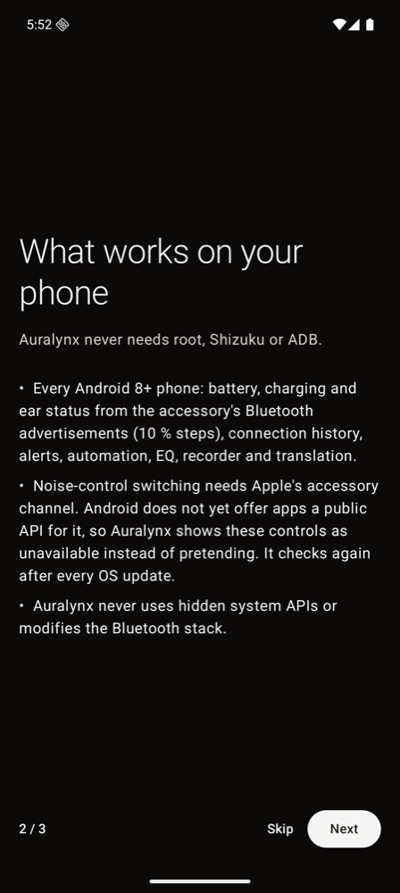
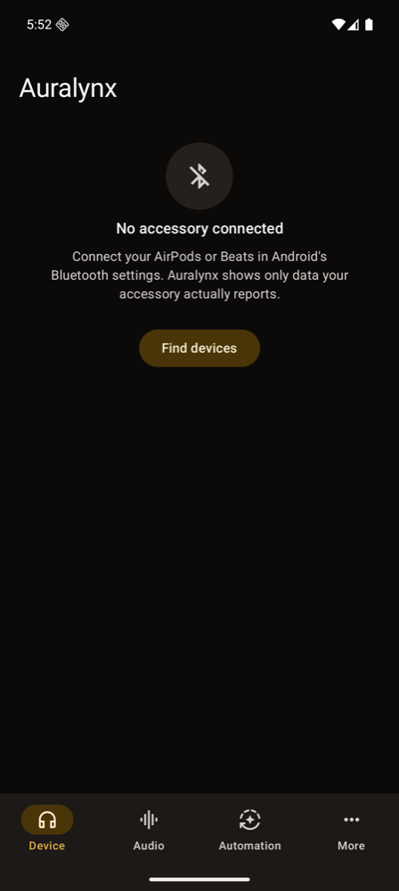
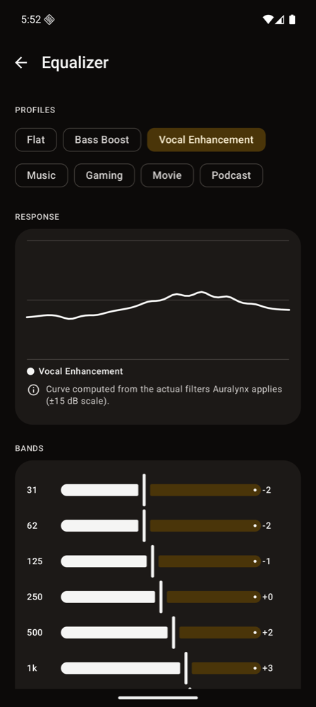
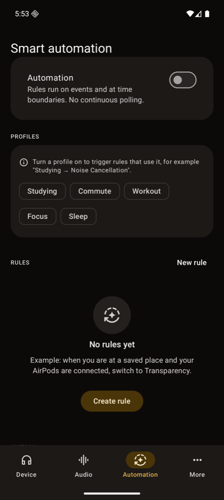
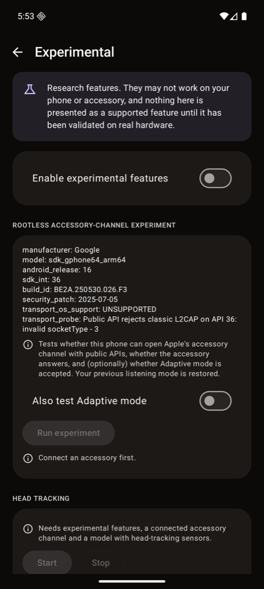
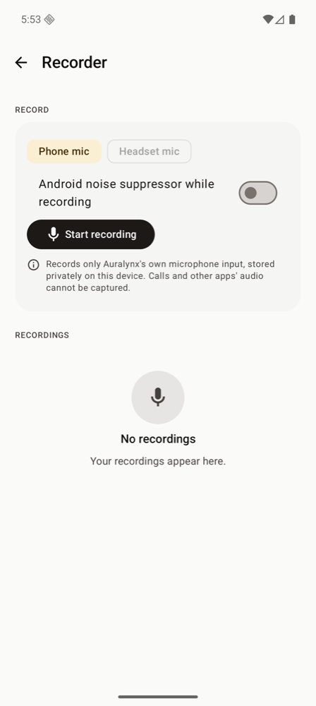

<div align="center">

# Auralynx

**Beyond Bluetooth. Beyond Boundaries.**

An open-source Android companion for Apple and Beats audio accessories: accessory status, smart
automation, audio tools and clearly labelled experimental research. No root, no Shizuku, no ADB setup,
no account, no analytics.

[Status](docs/IMPLEMENTATION_STATUS.md) · [Compatibility](COMPATIBILITY.md) · [Architecture](ARCHITECTURE.md) ·
[Building](BUILDING.md) · [Privacy](PRIVACY.md) · [Roadmap](ROADMAP.md)

</div>

> [!IMPORTANT]
> **Experimental alpha (v0.1.0-alpha).** Auralynx has been built and tested on emulators and with
> protocol-level unit tests. **It has not yet been validated with physical AirPods or Beats hardware.**
> See [Hardware validation status](#hardware-validation-status).

> [!NOTE]
> Auralynx is an independent project. It is not affiliated with, endorsed by or sponsored by Apple Inc.
> AirPods, AirPods Pro, AirPods Max, Beats and Apple Watch are trademarks of Apple Inc., used here only to
> describe compatibility.

## What works without root (and what does not)

Apple accessories expose information in three ways. Auralynx uses each one only where Android allows it:

| Channel | How Auralynx uses it | Available to apps on stock Android? |
|---|---|---|
| **Standard Bluetooth** (A2DP/HFP) | Connection state, connection history, HFP battery indicator where the phone reports it | ✅ Yes (public APIs) |
| **BLE proximity advertisements** | Left/right/case battery (10 % steps), charging, in-ear status, lid state, model | ✅ Yes (public BLE scanning, no location use on Android 12+) |
| **Apple accessory channel (AAP over classic L2CAP, PSM 0x1001)** | Noise-control switching, conversation awareness, 1 % battery, ear detection, press events, rename | ❌ **No public API as of Android 17 QPR2 (API 37.2)** |

The last row is the important one. Auralynx contains a complete, unit-tested implementation of the
accessory protocol, but it opens the channel **only through public SDK APIs**. As of Android 17 the public
`BluetoothSocketSettings` builder rejects classic L2CAP (`invalid socketType - 3`); the only classic-L2CAP
factories are hidden (`@hide`) system methods. Other projects reach them with hidden-API bypass libraries;
Auralynx deliberately does not. The app probes the public API at runtime and will enable the channel
automatically if a future Android release allows it. Evidence and method:
[docs/research/ROOTLESS_COMPATIBILITY.md](docs/research/ROOTLESS_COMPATIBILITY.md).

What this means today: on stock Android, **noise-control switching, conversation awareness and other
accessory settings are shown as unavailable, with the reason**, rather than as buttons that do nothing.

## Features

| Feature | Status | Notes |
|---|---|---|
| Device discovery (paired, connected, nearby advertisements) | Implemented | Companion-device linking for background monitoring |
| Device dashboard with capability registry | Implemented | Every feature shows *why* it is or is not available |
| Battery monitoring and analytics | Implemented | Real samples only, precision shown per value; discharge estimates labelled as estimates; no battery-health numbers |
| Low-battery, fully-charged and unexpected-disconnect alerts | Implemented | Opt-in where privacy-relevant |
| Ear detection → auto pause/resume | Implemented | Needs ear-detection data from the accessory channel |
| Noise control, conversation awareness, adaptive level, long-press cycle, rename | Implemented, **not operable on stock Android** | Requires the accessory channel (see above) |
| Smart automation (time, place, Wi-Fi, accessory, app, activity, profile) | Implemented | Priority + specificity conflict resolution, manual override, history, permission-on-demand, no polling |
| Equalizer (10-band, 7 presets, custom profiles) | Implemented | Applies to Auralynx playback and to players that publish their audio session. **Not system-wide.** |
| Spatial audio (crossfeed, virtual speakers, virtual room) | Experimental | App-local player only; generic spherical-head model, **not** Apple Personalized Spatial Audio |
| Audio recorder (noise reduction, voice enhancement, WAV/AAC export) | Implemented | Own microphone only; headset mic via standard hands-free route |
| Live translation (speech → translation → speech) | Implemented | System on-device translation (Android 12+, where the phone provides it) or **your own** LibreTranslate server (off by default) |
| Proximity finder | Implemented | Signal-strength guidance, not distance; last-seen location is opt-in. No Find My network access. |
| Security & privacy center | Implemented | Permissions, connection history, redacted diagnostic export, delete-all-data |
| Gesture automation | Implemented, **not operable on stock Android** | Press events come over the accessory channel |
| AirPods Max dashboard | Implemented | AirPods Max control over the accessory channel is unverified by any open implementation |
| Quick Settings tiles, widget, shortcuts, notification | Implemented | |
| Apple Watch research | Research only | Passive Continuity observer; **no pairing**. See [research](docs/research/APPLE_WATCH.md). |
| Head tracking | Experimental | Raw data + manual calibration; needs the accessory channel |

Full matrix: [docs/IMPLEMENTATION_STATUS.md](docs/IMPLEMENTATION_STATUS.md). Validation summary: [docs/VALIDATION_REPORT.md](docs/VALIDATION_REPORT.md).

## Screenshots

Captured from the v0.1.0-alpha debug build on an Android 16 emulator **with no accessory connected**,
so they show the real empty and unavailable states rather than invented data.

| | | |
|---|---|---|
|  |  |  |
|  |  |  |

More in [docs/screenshots](docs/screenshots).

## Supported devices

Models are identified from BLE advertisements and, when available, device information. Status per
model and per feature: [COMPATIBILITY.md](COMPATIBILITY.md). Summary:

- **AirPods**: 1st–3rd generation, AirPods 4, AirPods 4 with ANC, AirPods Pro (1st gen), AirPods Pro 2 (Lightning and USB-C), AirPods Pro 3
- **AirPods Max**: Lightning, USB-C, AirPods Max 2
- **Beats**: Powerbeats3/4, Powerbeats Pro/Pro 2, BeatsX, Beats Flex, Solo3/Solo Pro/Solo 4, Studio3/Studio Pro, Studio Buds/Buds +, Fit Pro, Solo Buds (battery and status from advertisements)

Phone requirements: Android 8.0 (API 26) or newer with Bluetooth Low Energy.

## Install

Release downloads will appear on the project's GitHub Releases page once a release is published. Until
then, build from source (below). Pre-release builds:

- **Debug APK**: installable on any device (`adb install` or a file manager). Uses the debug signing key.
- **Release APK**: published unsigned unless the maintainers configure a signing key; unsigned APKs cannot be installed until signed.

Verify downloads with `SHA256SUMS` (`shasum -a 256 -c SHA256SUMS`).

## Build

```bash
git clone https://github.com/<owner>/auralynx-android.git
cd auralynx-android
./gradlew assembleDebug          # app/build/outputs/apk/debug/app-debug.apk
./gradlew testDebugUnitTest :core:common:test :core:protocol:test :core:automation:test :core:dsp:test
```

Requirements: JDK 17, Android SDK Platform 37 and Build-Tools 37. Details, signing and reproducibility:
[BUILDING.md](BUILDING.md).

## Privacy

No account, no analytics, no advertising, no background network use. All history stays on the phone.
Location, microphone, activity and usage access are requested only when you turn on a feature that needs
them. The only network feature, cloud translation, is off by default and talks only to a server you
configure. Full policy: [PRIVACY.md](PRIVACY.md).

## Hardware validation status

| Area | Status |
|---|---|
| Protocol parsing/encoding | Unit-tested against packets published in public protocol documentation |
| Accessory engine (sessions, recovery, capabilities) | Unit-tested with a scripted fake accessory (not hardware) |
| Database, UI navigation | Instrumentation-tested on an Android 16 (API 36) emulator |
| Real AirPods/Beats | **Not yet tested.** Help wanted: [device testing checklist](docs/DEVICE_TESTING_CHECKLIST.md) |

## Contributing

Contributions are welcome, especially hardware test reports. See [CONTRIBUTING.md](CONTRIBUTING.md) and
the [Code of Conduct](CODE_OF_CONDUCT.md). Security issues: [SECURITY.md](SECURITY.md).

## License

Auralynx is free software, licensed under the **GNU General Public License v3.0 or later**
([LICENSE](LICENSE)). Third-party components and research credits: [NOTICE](NOTICE) and
[THIRD_PARTY_NOTICES.md](THIRD_PARTY_NOTICES.md).

## Roadmap

See [ROADMAP.md](ROADMAP.md). Next milestones: hardware validation with community testers, an
opt-in accessory-channel transport for users who choose it, and localisation.
